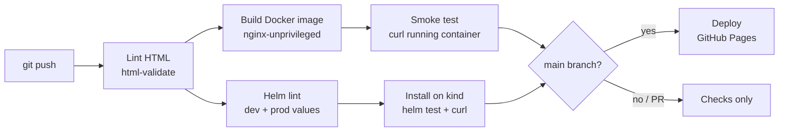

# Shobhin Gowrisankar | DevOps Portfolio


Personal portfolio site for **Shobhin Gowrisankar Balasubramaniam**, DevOps and Site Reliability Engineer based in Atlanta, GA.

**Live site:** https://shobhin15.github.io

The site itself is delivered through a small CI/CD pipeline: every push is linted, built into a container, smoke-tested, and deployed to GitHub Pages only when every stage passes.

## Pipeline



| Stage | What it does |
|---|---|
| **Lint** | Validates the HTML with `html-validate` so broken markup never ships |
| **Build** | Packages the site into an NGINX container image |
| **Smoke test** | Runs the container and checks the page responds with the expected content |
| **Helm** | Lints the chart for every environment, installs it on a throwaway kind cluster, runs `helm test`, and curls the Service |
| **Deploy** | Publishes to GitHub Pages; runs only on `main` after all checks pass |

Pull requests run every check without deploying.

## Run locally

With Docker:

```bash
docker build -t portfolio .
docker run -d -p 8080:8080 portfolio
# open http://localhost:8080
```

Without Docker:

```bash
cd site && python3 -m http.server 8080
```

## Deploy to Kubernetes with Helm

The site is also packaged as a Helm chart in `charts/portfolio`, built the way I'd ship a real service:

- **Non-root and locked down:** runs as UID 101 with a read-only root filesystem, all Linux capabilities dropped, and the RuntimeDefault seccomp profile
- **Zero-downtime rollouts:** readiness and liveness probes with `maxUnavailable: 0`
- **Per-environment values:** `values-dev.yaml` (one small replica) and `values-prod.yaml` (HorizontalPodAutoscaler, PodDisruptionBudget, Ingress)
- **Built-in test:** `helm test` starts a pod that checks the Service returns the page

Try it on a local cluster with [kind](https://kind.sigs.k8s.io/):

```bash
kind create cluster --name portfolio
docker build -t portfolio:local .
kind load docker-image portfolio:local --name portfolio

helm install portfolio charts/portfolio -f charts/portfolio/values-dev.yaml --set image.tag=local --wait
helm test portfolio
kubectl port-forward svc/portfolio 8080:80   # open http://localhost:8080

# clean up
kind delete cluster --name portfolio
```

Preview what prod would create without installing anything:

```bash
helm template portfolio charts/portfolio -f charts/portfolio/values-prod.yaml
```

## Repository layout

```
.
├── .github/workflows/deploy.yml   # CI/CD pipeline
├── site/index.html                # the portfolio page
├── charts/portfolio/              # Helm chart (dev and prod values files)
├── Dockerfile                     # non-root NGINX image for local runs and the smoke test
├── .htmlvalidate.json             # lint rules
└── README.md
```

## Contact

- LinkedIn: [www.linkedin.com/in/shobhin-gowrisankar](https://www.linkedin.com/in/shobhin-gowrisankar)
- Email: shobhingowrisankar@gmail.com
